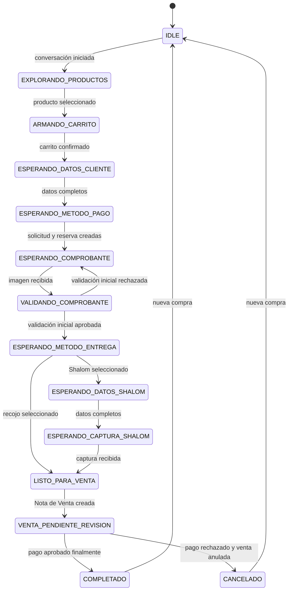

# Máquina de estados del agente de ventas por WhatsApp

## Objetivo

Esta máquina controla el orden comercial del agente Kiments. Gemini puede interpretar lo que desea la clienta y solicitar herramientas, pero no puede asignar estados directamente. Cada cambio ocurre únicamente después de que el backend valida y ejecuta un evento de `CrmWhatsappAgentEvent`.

La sesión siempre pertenece a una conversación y obtiene la sucursal desde la conexión de WhatsApp. La sucursal nunca forma parte de los argumentos elegidos por el modelo.

## Flujo principal

## Contrato de cada estado

| Estado | Significado | Datos que deben existir para salir correctamente |
|---|---|---|
| `IDLE` | No existe una compra activa. | Conversación válida y conexión WhatsApp con sucursal. |
| `EXPLORANDO_PRODUCTOS` | La clienta consulta catálogo, productos o promociones. | Producto real seleccionado para comenzar el carrito. |
| `ARMANDO_CARRITO` | Se agregan variantes, cantidades y promociones. | Carrito no vacío, stock y totales recalculados por Java. |
| `ESPERANDO_DATOS_CLIENTE` | Se solicitan nombre y celular. | Nombre y teléfono válidos, cliente vinculado sin duplicarlo. |
| `ESPERANDO_METODO_PAGO` | Se muestran métodos habilitados en la sucursal. | Método y cuenta válidos; todavía no implica que exista reserva. |
| `ESPERANDO_COMPROBANTE` | Existe una solicitud de pago y reserva activa de cuatro minutos. | Imagen asociada a la solicitud antes del vencimiento. |
| `VALIDANDO_COMPROBANTE` | Visión extrae datos y Java compara las reglas del pago. | Resultado inicial persistido como aprobado, observado o rechazado. |
| `ESPERANDO_METODO_ENTREGA` | El comprobante pasó la validación inicial. | Selección explícita de recojo o Shalom. |
| `ESPERANDO_DATOS_SHALOM` | Faltan nombre, DNI, celular, agencia o destino. | Todos los datos textuales de Shalom válidos. |
| `ESPERANDO_CAPTURA_SHALOM` | Faltan evidencias de agencia o destino. | Captura de Shalom vinculada a la sesión. |
| `LISTO_PARA_VENTA` | Carrito, cliente, pago inicial y entrega están completos. | Revalidación transaccional de todas las precondiciones. |
| `VENTA_PENDIENTE_REVISION` | Ya existe una Nota de Venta; falta revisión humana final. | Nota, pago, evidencia y entrega relacionados. |
| `COMPLETADO` | El pago fue aprobado definitivamente. | No se realizan más mutaciones sobre esa compra. |
| `CANCELADO` | La operación terminó sin venta válida o la venta fue anulada. | Reservas liberadas o stock devuelto exactamente una vez. |
| `REQUIERE_AYUDA` | Hay una excepción que no debe resolverse automáticamente. | Caso de soporte registrado. En el futuro se guardará también el estado de retorno. |

`COMPLETADO` y `CANCELADO` son terminales para la compra actual, pero aceptan `NUEVA_COMPRA_INICIADA` para limpiar el contexto y volver a `IDLE`.

## Reglas de seguridad

1. El estado se persiste después de completar el efecto de negocio, dentro de la misma transacción cuando corresponda.
2. La IA no puede saltar estados ni emitir directamente eventos de aprobación final.
3. `SOLICITUD_PAGO_CREADA` solo ocurre después de reservar stock correctamente.
4. `COMPROBANTE_APROBADO_INICIALMENTE` no equivale a la aprobación humana final.
5. `NOTA_VENTA_CREADA` solo ocurre si la Nota de Venta y sus relaciones quedaron guardadas.
6. `PAGO_RECHAZADO_Y_VENTA_ANULADA` solo ocurre después de anular la venta y devolver el stock.
7. Una cancelación solicitada después de aprobar inicialmente el comprobante pasa a `REQUIERE_AYUDA`; no se anula dinero o venta automáticamente.
8. Mientras se espera el comprobante, `CANCELACION_SOLICITADA` no cambia el estado: el servicio debe liberar primero la reserva y recién emitir `SOLICITUD_PAGO_CANCELADA`.
9. `AYUDA_RESUELTA` solo puede volver a `IDLE` después de comprobar que no quedan reservas, pagos o ventas pendientes. La reanudación del estado anterior se diseñará junto con la persistencia del paso 2.
10. Las transiciones repetidas se protegerán con versión optimista e idempotencia en los pasos de persistencia y jobs.
11. Si una captura de Shalom llega antes que los datos textuales, se conserva y la sesión continúa esperando los datos; al completarlos se revalida y avanza.

## Responsabilidad de los eventos críticos

| Evento | Único responsable autorizado |
|---|---|
| `SOLICITUD_PAGO_CREADA` | Servicio transaccional de pagos y reservas. |
| `COMPROBANTE_RECIBIDO` | Webhook de WhatsApp asociado a una solicitud activa. |
| `COMPROBANTE_APROBADO_INICIALMENTE` | Validador Java después del análisis visual. |
| `NOTA_VENTA_CREADA` | Servicio de Nota de Venta reservada. |
| `PAGO_APROBADO_FINALMENTE` | Acción autenticada del CRM. |
| `PAGO_RECHAZADO_Y_VENTA_ANULADA` | Acción autenticada del CRM después de anulación exitosa. |
| `SOLICITUD_PAGO_EXPIRADA` | Proceso de expiración del backend. |
| `SOLICITUD_PAGO_CANCELADA` | Servicio de pagos después de liberar la reserva. |

## Alcance del paso 1

Este paso no persiste todavía el estado, no crea tablas y no conecta Gemini. La persistencia, concurrencia e idempotencia se implementarán en el paso 2 usando este contrato como fuente única de verdad.
